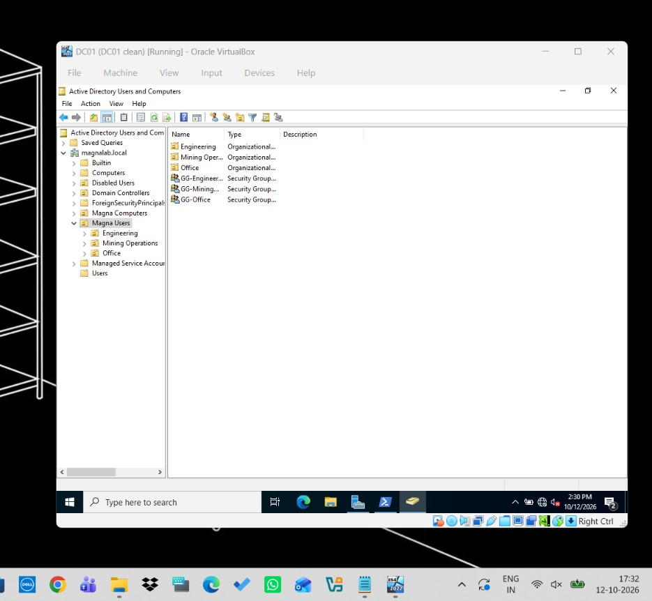
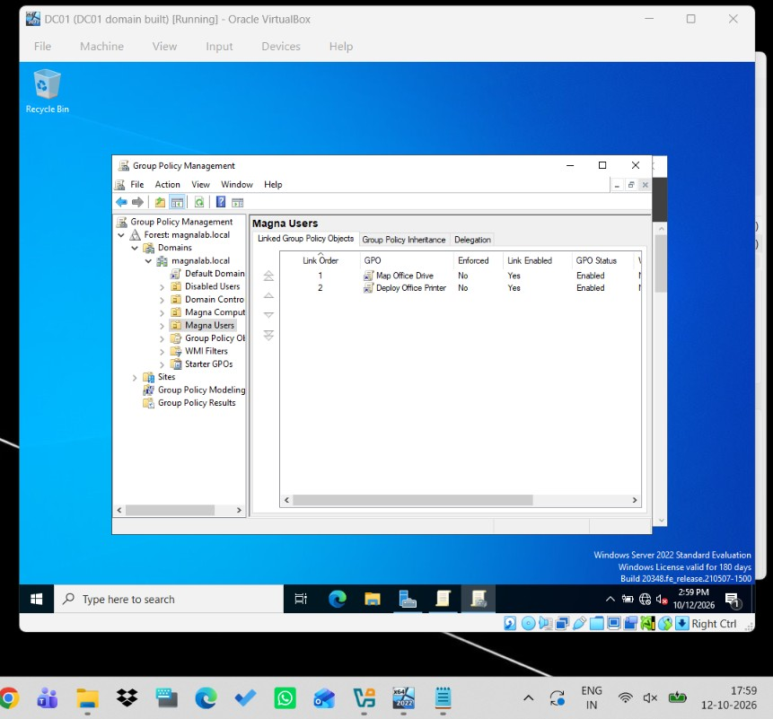
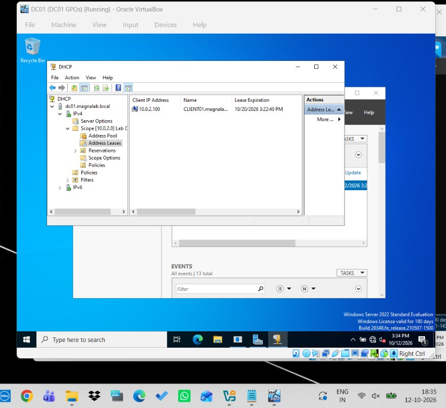
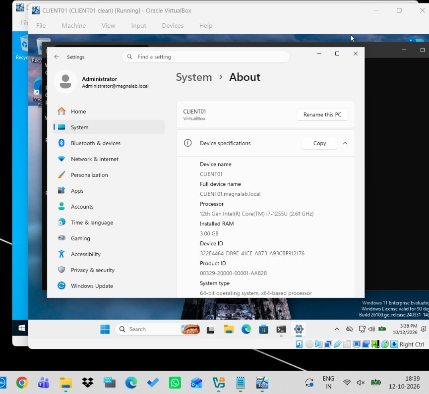
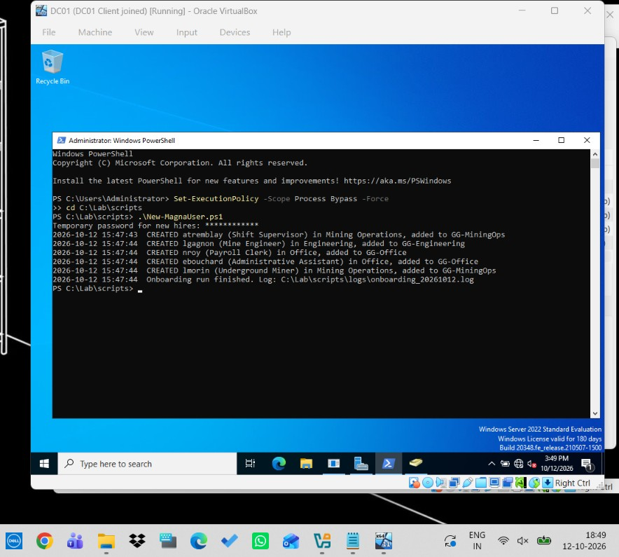
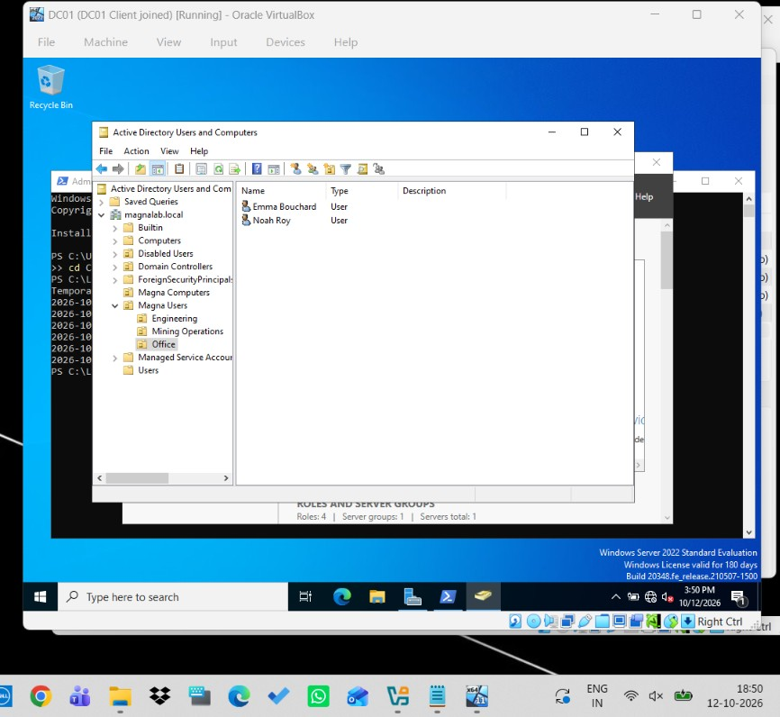
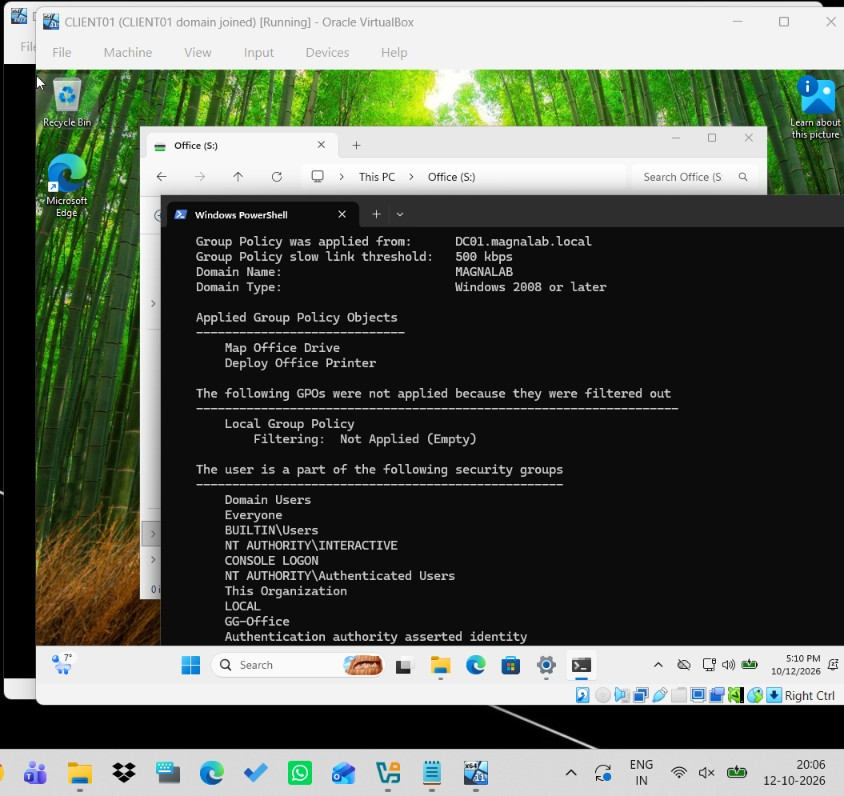
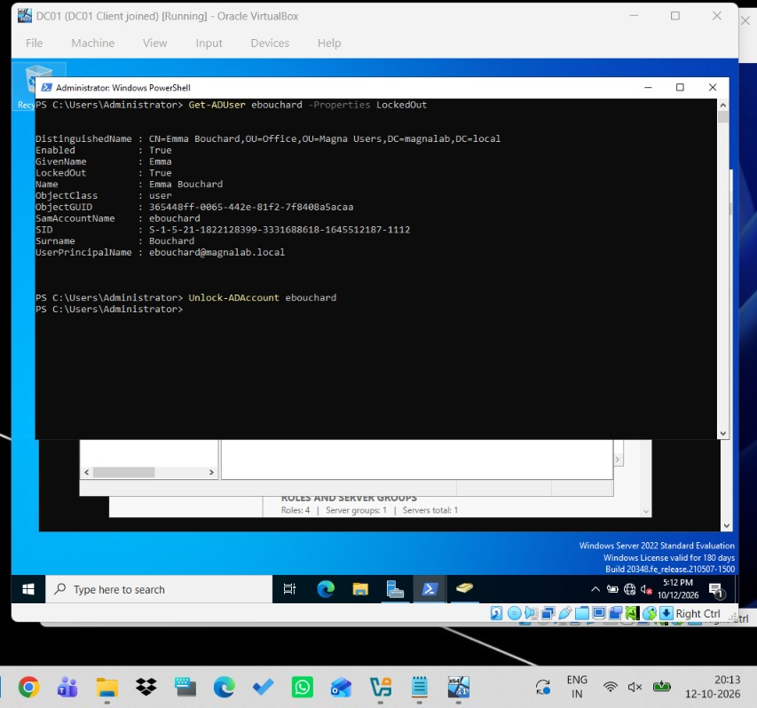
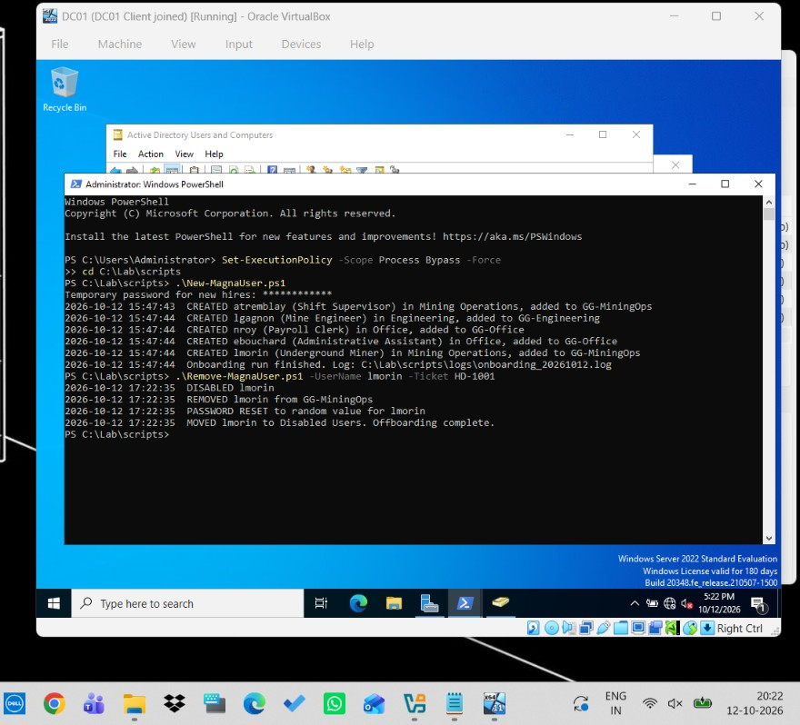
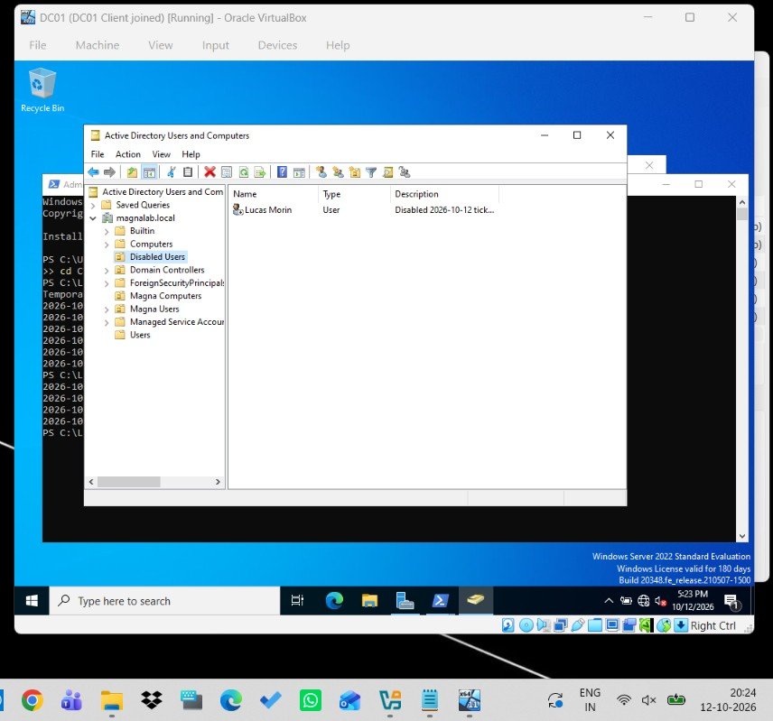

# Active Directory Admin Lab

A small Windows domain built to practise the day-to-day work of an IT support analyst: onboarding and offboarding users, controlling access with groups and Group Policy, and documenting fixes as runbooks.

## Lab setup

| Machine | Role | IP |
|---|---|---|
| DC01 | Windows Server 2022, domain controller, DNS, DHCP, file and print | 10.0.2.10 (static) |
| CLIENT01 | Windows 11 Enterprise, domain-joined workstation | DHCP 10.0.2.100 to 200 |

Domain: `magnalab.local`. Both VMs run in VirtualBox on an isolated NAT network.

## What it does

- **Active Directory structure.** OUs for Mining Operations, Engineering and Office users, a Magna Computers OU (new PCs land there by default) and a Disabled Users OU.
- **Least-privilege access.** One security group per department. The Office share is writable only by GG-Office.
- **Group Policy.** Account lockout after 5 bad attempts, S: drive mapped only for Office staff (item-level targeting), and a shared printer pushed to users.
- **Onboarding script** (`New-MagnaUser.ps1`). Reads new hires from a CSV, creates each account in the right OU with a temporary password that must be changed at first logon, adds the department group, and logs every action. Skips duplicates and bad rows instead of failing.
- **Offboarding script** (`Remove-MagnaUser.ps1`). Disables the account, removes group access, scrambles the password, records the date and ticket number, and moves it to Disabled Users.
- **Runbooks** for onboarding, offboarding, password reset and unlock, "user cannot log in", and Group Policy setup.

## Build order

1. `01-Configure-DC01.ps1`: static IP and rename
2. `02-Install-ADDS.ps1`: AD DS, DNS, DHCP and new forest
3. `03-Configure-DNS-DHCP.ps1`: DNS forwarder and DHCP scope
4. `04-Build-OUs-Groups-Share.ps1`: OUs, groups, share and printer
5. Group Policy in the GUI (runbook 05)
6. `05-Join-Client.ps1` on CLIENT01
7. `New-MagnaUser.ps1` and `Remove-MagnaUser.ps1`

## Screenshots

| | |
|---|---|
| OU structure, groups and departments |  |
| GPOs linked on Magna Users |  |
| DHCP lease for CLIENT01 |  |
| CLIENT01 joined to magnalab.local |  |
| Onboarding script creating 5 users |  |
| New users in the Office OU |  |
| S: drive mapped and gpresult for an Office user |  |
| Account locked after 5 bad attempts, then unlocked |  |
| Offboarding script output |  |
| Leaver in Disabled Users |  |

## What I learned

- A domain client must use the DC for DNS, otherwise it cannot find the domain to join or log in.
- Disable a leaver's account before anything else. Deleting it straight away breaks file ownership and audit history.
- Item-level targeting lets one GPO serve one department without creating extra OUs.
